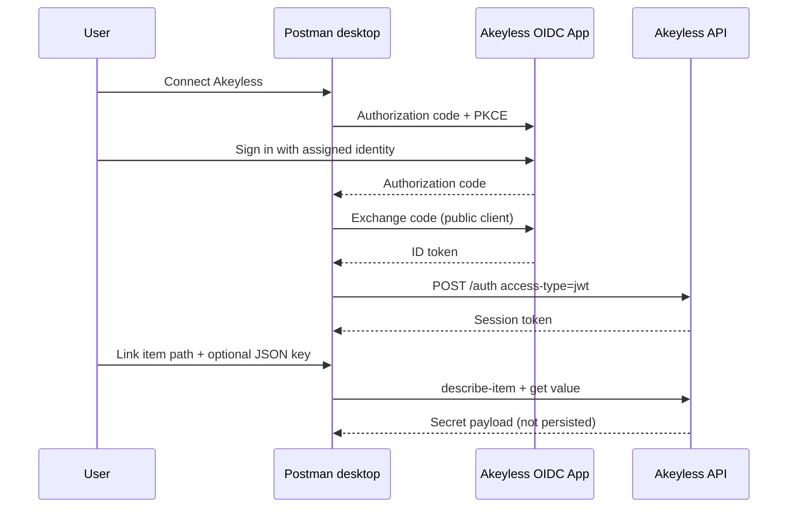

# Akeyless connector for Postman

**Status:** Akeyless-side setup, reference client, and connector spec are ready. Akeyless does not yet appear in Postman Local Vault — that ships when Postman adds this as a native desktop connector.

Native Postman Local Vault integration with [Akeyless](https://www.akeyless.io). After Postman ships this connector, **Akeyless** appears in Local Vault as a built-in secret-manager connector.

Users authenticate with their Akeyless identity in the browser. Secrets stay in Akeyless and are resolved when an HTTP request runs. Values are not stored in the Postman cloud.

This repository is the Akeyless-side package for that native connector:

- Admin setup script (OIDC App + JWT auth method + Access Role)
- Reference TypeScript client Postman implements in the desktop app
- Verification CLI that uses the same loopback ports Postman uses
- Customer guide and the native-connector specification

## How it works



1. A Postman Admin enters the Akeyless API URL, OIDC issuer URL, public Client ID, and JWT Access ID.
2. Each teammate signs in through Akeyless (browser). Postman uses OAuth 2.0 authorization code with PKCE on `http://127.0.0.1:10545/` and `http://127.0.0.1:10534/`.
3. Postman exchanges the ID token for an Akeyless session (`POST /auth`, `access-type=jwt`).
4. Linked secrets are resolved by **item path** and optional **JSON key** from static, dynamic, and rotated secrets.

## Prerequisites

- Akeyless account and [CLI](https://docs.akeyless.io/docs/cli)
- An Authentication Method or Group that users will sign in with (assigned to the OIDC App)
- Postman desktop app with Local Vault (Enterprise, Advanced Security Administration add-on)
- Network access from each user's machine to the Akeyless API (or Gateway) and `https://auth.akeyless.io`

## 1. Set up Akeyless

Run the setup script as an Akeyless admin. It creates a **public** OIDC App, an OAuth2/JWT authentication method that trusts that issuer, and an Access Role with `read` on the item path you choose.

```bash
chmod +x scripts/akeyless-setup-postman.sh

# Allow a specific authentication method to use the OIDC App
./scripts/akeyless-setup-postman.sh --access-id p-xxxxx --item-path '/postman/*'

# Or allow an entire group
./scripts/akeyless-setup-postman.sh --group-id g-xxxxx --item-path '/postman/*'
```

The script prints the four values a Postman Admin enters in Local Vault settings:

| Postman field | Source |
| --- | --- |
| API URL | `https://api.akeyless.io` or your Gateway `https://<host>:8000/api/v2` |
| OIDC Issuer URL | `https://auth.akeyless.io/oidc/provider/<account_id>` |
| Client ID | Public OIDC App client ID |
| JWT Access ID | OAuth2/JWT authentication method Access ID |

Do not change the OIDC App redirect URIs. They must remain:

```
http://127.0.0.1:10545/
http://127.0.0.1:10534/
```

### Manual setup

If you prefer the Console or CLI by hand, see [docs/user-guide.md](docs/user-guide.md).

## 2. Verify before Postman (optional)

The verify CLI opens the same browser login Postman will use and never prints secret values:

```bash
npm run verify -- \
  --api-url https://api.akeyless.io \
  --issuer-url https://auth.akeyless.io/oidc/provider/acc-xxxxx \
  --client-id c-xxxxx \
  --jwt-access-id p-xxxxx \
  --item-path /postman/demo \
  --secret-key password
```

Success looks like:

```json
{"ok":true,"itemPath":"/postman/demo","itemType":"STATIC_SECRET","secretKey":"password","valueLength":12}
```

## 3. Connect in Postman

These steps match the native connector UI after Postman ships Akeyless.

### Admin: create the integration

1. Open **Local Vault** → **Settings**.
2. Next to **Akeyless**, select **Set Up Integration**.
3. Enter **API URL**, **OIDC Issuer URL**, **Client ID**, and **JWT Access ID**.
4. Optionally enter **Scope** (`openid email` if you used the setup script).
5. Select **Set Up Akeyless**.

Only a Postman Admin or Super Admin can create or edit this integration. The whole team uses the same Akeyless account.

### Each user: authenticate

1. Open **Local Vault**.
2. Select **Set up external vault** or **Use from existing vault**, then **Akeyless**.
3. Complete the Akeyless sign-in in the browser, then return to Postman.

You need to sign in again when you reopen Postman or when the session expires. Authentication credentials and retrieved secrets are not stored in Postman or the Postman cloud.

Do not use an API Key in the browser login for this flow. Sign in with an identity that was assigned to the OIDC App (for example SAML, OIDC, email, or cloud IAM).

### Link a secret

1. Enter a name for the vault secret.
2. Hover over **Value**, select **Link Vault**, then **Akeyless**.
3. Enter:

   | Field | Description |
   | --- | --- |
   | Item path | Full Akeyless path, for example `/prod/api/credentials` |
   | Secret key | Optional JSON field (`password`, `api_key`, `data.token`). Leave empty to use the entire value |
   | Version | Optional. Static secrets only. Latest version if omitted |

4. Select **Use**.

Supported item types: **static**, **dynamic**, and **rotated** secrets. Postman calls `describe-item` and then the matching get-value API.

Reference the linked secret in requests the same way you reference other Local Vault secrets. Enable scripts if you read vault secrets from tests.

Signing out of Postman clears local links. After you sign back in, reconnect and link the items again.

## Zero-Knowledge / Gateway

If the account uses a customer key fragment, set **API URL** to the Gateway REST endpoint, for example `https://Your_GW_URL:8000/api/v2`. OIDC discovery still uses `https://auth.akeyless.io` unless you run a private authentication endpoint (`AKEYLESS_AUTH_HOST` on the setup script).

## Security notes

- The OIDC App is a **public** client. Postman uses PKCE. There is no client secret in the desktop app.
- Redirect URIs are loopback-only. The setup script refuses to run if those URIs are missing.
- The reference client and verify CLI never log secret values, tokens, or ID tokens.
- Retrieved secrets must not be written to Postman cloud storage. Session tokens live in memory until Postman is closed or the token expires.

## Native connector specification

Postman engineering: [docs/native-connector-spec.md](docs/native-connector-spec.md).

## Development

```bash
npm install
npm test
npm run build
```

## License

MIT
